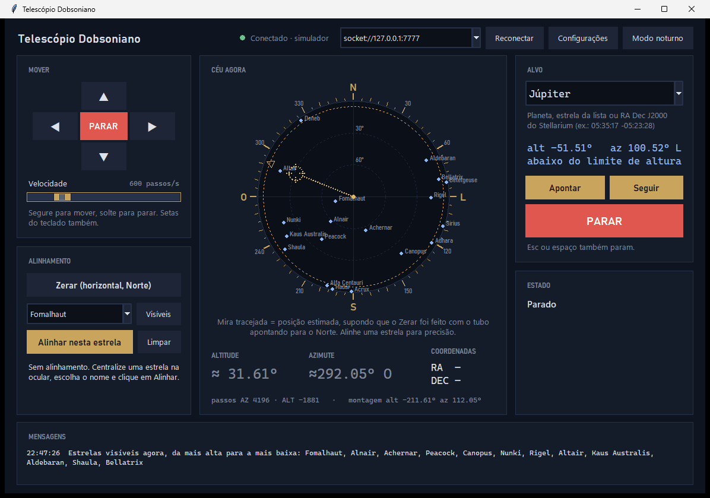

# Telescópio Dobsoniano motorizado

Controle de um telescópio de montagem **Dobsoniana** (alt-azimutal) pelo computador:
mover à mão, **apontar sozinho** para um objeto (GoTo) e **seguir** o objeto
compensando a rotação da Terra.

Hardware: **Arduino Duemilanove**, Bluetooth **HC-06**, 2 drivers **DRV8825** e 2
motores **NEMA 17**. Software do PC em **Python** com [skyfield](https://rhodesmill.org/skyfield/).



> **Situação:** o software está pronto e testado **contra um simulador**. **Ainda não
> foi testado no hardware real.** O [roteiro do primeiro teste](specs/testes.md#roteiro-do-primeiro-teste-no-hardware)
> diz o que conferir, na ordem.

## Como funciona

O **PC é o cérebro**: calcula onde está o objeto no seu céu, converte para passos dos
motores e manda o Arduino mover. O **Arduino só executa passos**, o que permite usar
uma placa simples como a Duemilanove.

```
   PC (Python)                 Arduino Duemilanove           Hardware
 ┌───────────────┐   texto   ┌─────────────────────┐       ┌───────────┐
 │ skyfield:     │  via BT   │ controlador "burro" │ STEP/ │ 2x DRV8825│→ NEMA 17 AZ
 │ coordenadas,  │ ────────► │ só executa PASSOS   │ DIR   │           │→ NEMA 17 ALT
 │ alinhamento,  │ ◄──────── │ (AccelStepper)      │ ─────►│           │
 │ rastreamento  │   POS?    └─────────────────────┘       └───────────┘
 └───────────────┘
```

- **Alinhamento** com 1 ou mais estrelas. Com 2 ou mais, o sistema calcula a rotação
  entre a montagem e o céu e corrige a base desnivelada e o Norte desconhecido.
- **Rastreamento por velocidade:** a cada segundo, lê a posição real dos motores e
  ajusta a velocidade para chegar onde o objeto vai estar.
- **Tela** com radar do céu (você no centro, Norte em cima, Leste à direita), mira
  mostrando para onde o tubo aponta e modo noturno vermelho.

## Começando

**Guia completo, do zero:** [specs/instalacao.md](specs/instalacao.md) (instalar o
Python, gravar o Arduino, parear o Bluetooth, problemas comuns).

Resumo, num PowerShell aberto na pasta `pc` (Windows 10/11, Python 3.11+):

```powershell
py -m venv .venv
.venv\Scripts\python -m pip install -r requirements.txt
.venv\Scripts\python -c "import astro; astro.Ceu(0, 0)"     # baixa a efeméride (~17 MB), só na 1ª vez
```

Os comandos usam `.venv\Scripts\python` direto porque o `activate` costuma ser
bloqueado pela política padrão do PowerShell.

**Sem hardware (simulador):** em um PowerShell, `.venv\Scripts\python simulador.py`;
em outro, `.venv\Scripts\python tela.py socket://127.0.0.1:7777`.

**Com hardware:** grave `firmware/controlador/controlador.ino` (biblioteca AccelStepper;
placa "Arduino Duemilanove or Diecimila"; processador ATmega328P ou ATmega168, conforme
o chip), monte as ligações de [specs/hardware.md](specs/hardware.md) e rode
`.venv\Scripts\python tela.py`. O Arduino atende **pelo cabo USB ou pelo HC-06**;
escolha a porta COM no topo da janela.

### Uma noite de observação

1. **Configurações:** local (ou **Usar minha localização do Windows**) e a redução real de cada eixo.
2. **Zerar** com o tubo na horizontal e apontando para o Norte.
3. Centralize uma estrela com os botões de mover, escolha o nome e clique **Alinhar**.
   Repita com uma 2ª estrela a 60–120° da primeira.
4. Escolha o alvo e clique **Apontar** ou **Seguir**. **PARAR** (ou Esc, ou espaço) para tudo.

Também há um app de texto (`python telescopio.py`) com os mesmos comandos.

## Cuidados antes de ligar o hardware

- **Capacitor de ~100 µF entre VMOT e GND** de cada DRV8825; sem ele, o driver queima.
- **RST e SLP** do DRV8825 ligados juntos em nível alto.
- **Divisor de tensão** no RX do HC-06 (ele tolera 3,3 V; o Arduino é 5 V).
- **Ajuste o Vref** antes de girar o motor: `Vref = corrente do motor ÷ 2`.

Detalhes em [specs/hardware.md](specs/hardware.md).

## Testes

```powershell
cd pc
.venv\Scripts\python -m unittest discover -s testes -v
```

Com a efeméride baixada, 35 testes rodam (protocolo, geometria, alinhamento, GoTo e
rastreamento contra o simulador) e terminam em `OK (skipped=6)`: os 6 da tela são
opcionais porque abrem janelas. Ver [specs/testes.md](specs/testes.md).

## Documentação

| | |
|---|---|
| [specs/instalacao.md](specs/instalacao.md) | instalação passo a passo e problemas comuns |
| [specs/requisitos.md](specs/requisitos.md) | objetivo, escopo e premissas |
| [specs/hardware.md](specs/hardware.md) | materiais, ligações, Vref, mecânica |
| [specs/firmware.md](specs/firmware.md) | Arduino e protocolo serial |
| [specs/arquitetura.md](specs/arquitetura.md) | módulos Python e threads da tela |
| [specs/modelo-matematico.md](specs/modelo-matematico.md) | coordenadas, alinhamento, rastreamento |
| [specs/interface.md](specs/interface.md) | tela de controle e app de texto |
| [specs/testes.md](specs/testes.md) | testes e roteiro do teste no hardware |
| [specs/pendencias.md](specs/pendencias.md) | limitações e próximos passos |

## Estrutura

```
firmware/controlador/   firmware do Arduino
pc/                     software do PC (tela.py é o ponto de entrada)
pc/testes/              testes automatizados
specs/                  especificações
docs/                   imagens
```

## Licença

[MIT](LICENSE): use, modifique e redistribua à vontade, mantendo o aviso de autoria.
Sem garantia: confira as ligações elétricas antes de energizar o hardware.
